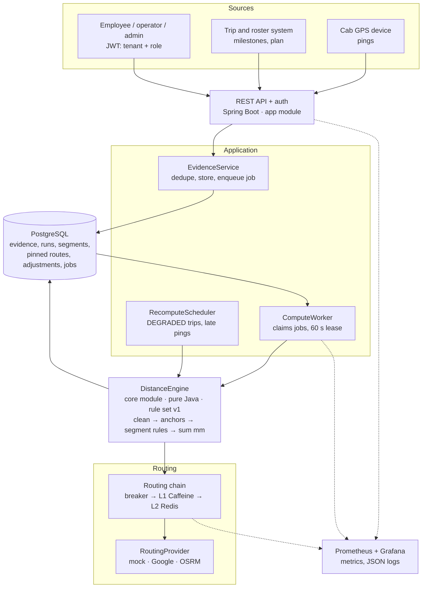
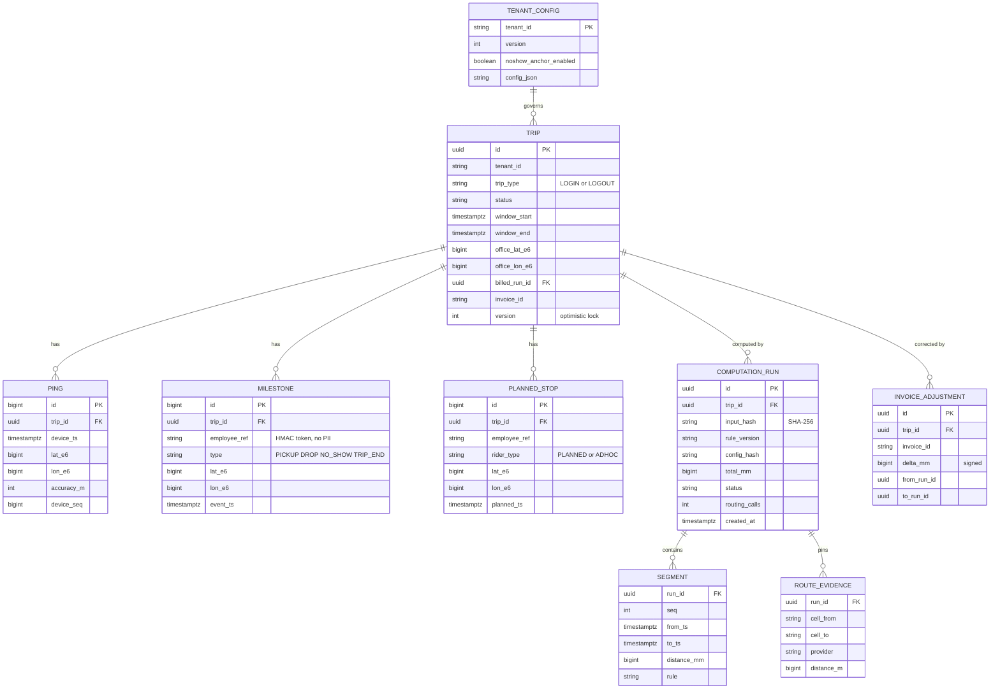
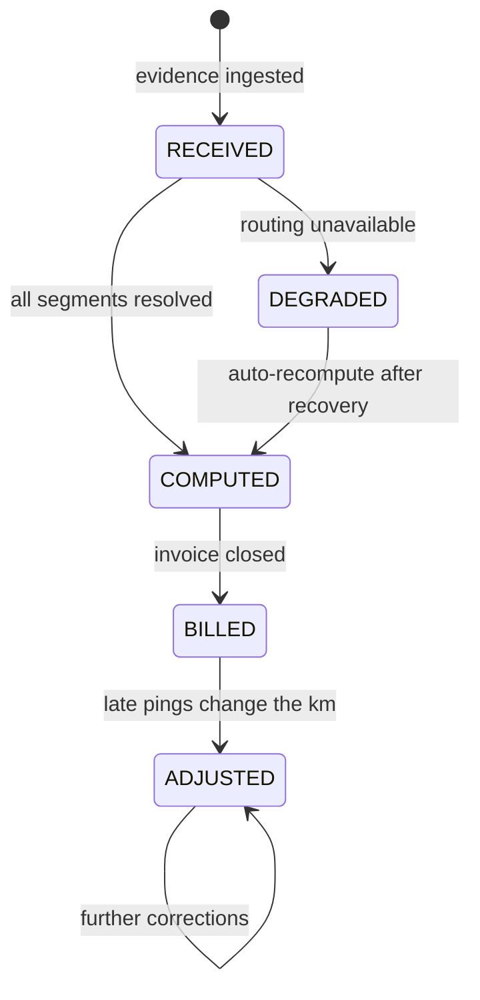
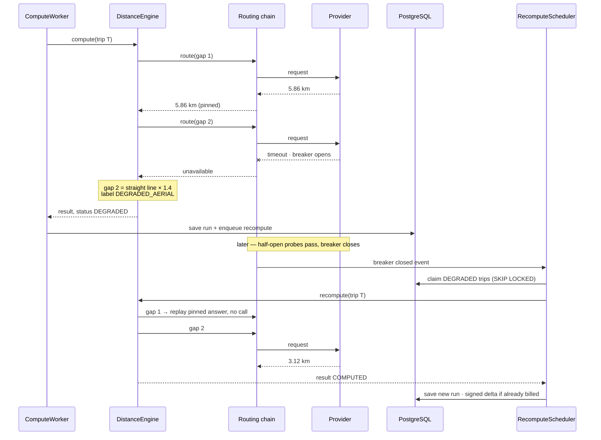

# TripLedger — Design Note

> Written **before** the code (case study instruction 3). It fixes the data model, the components, the APIs and the failure modes. Later segments implement exactly this; any change is recorded in the [change log](#14-change-log) at the end.

---

## 1. Problem in one paragraph

A vendor is paid per kilometre, and the kilometres come from GPS pings that drop out in tunnels and basements, repeat, arrive late or jump kilometres in a second. TripLedger rebuilds the billable distance of each trip so that it is **correct** (no over- or under-payment), **explainable** (every segment carries the rule that produced it), **deterministic** (same input + same rule version = same metres, every run) and **cheap** (paid routing calls only where a real gap exists).

**Worked example from the case study:** naive ping sum 18.4 km, true ≈ 31 km. TripLedger: ≈ 30.6 km using 2 routing calls.

---

## 2. Architecture



**Key rule:** the `DistanceEngine` never touches the network, a database or the clock. Workers hand it the evidence and any pinned route answers; it returns kilometres with a label on every segment. This is what makes it testable without a server (instruction 4) and deterministic.

---

## 3. Components and code layout

### 3.1 Modules

| Module | Purpose | Depends on Spring? |
|---|---|---|
| `core` | Domain, cleaning filters, anchor resolvers, segment rules, engine | **No** (a test enforces this) |
| `app` | REST controllers, services, JPA repositories, security, routing adapters, jobs, metrics | Yes |
| `mock-router` *(S4)* | Fake routing provider with a fault switch for demos and tests | Yes |
| `bench` *(S9)* | Seeded data generator and 10,000-trip benchmark runner | No |

### 3.2 Packages

| Package | Contains | Segment |
|---|---|---|
| `core.model` | `GeoPoint`, `Ping` (S2); `Milestone`, `PlannedStop`, `TripEvidence`, `Anchor`, `Segment`, `TripDistance` (S3) | S2, S3 |
| `core.geo` | `Haversine` (StrictMath), `Distance` (integer millimetres), `Kinematics` (implied speed) | S2 |
| `core.config` | `BillingRules` record — every threshold in one place | S2 |
| `core.cleaning` | `PingFilter` interface; `InvalidCoordinateFilter`, `DuplicateFilter`, `TimeOrderFilter`, `AccuracyFilter`, `TeleportFilter`; `CleaningPipeline` + `CleaningReport` | S2 |
| `core.anchor` | `AnchorResolver` interface; `EmployeeAnchorResolver`, `NoShowAnchorResolver`, `OfficeAnchorResolver` | S3 |
| `core.rules` | `SegmentRule` interface; `AbstractAerialRule`; rules 0–6; `RuleSet` (ordered, versioned) | S3 |
| `core.engine` | `DistanceEngine`, `RouteLookup` port (implemented in `app`) | S3 |
| `app.api` | Controllers, request/response DTOs, `@RestControllerAdvice` | S5, S6 |
| `app.service` | `EvidenceService`, `DistanceService`, `AdjustmentService` | S5, S7 |
| `app.persistence` | JPA entities + Spring Data repositories, Flyway migrations | S5 |
| `app.routing` | `RoutingProvider`, `CachingRouteLookup`, `CircuitBreakingProvider`, HTTP client | S4 |
| `app.jobs` | `JobQueue`, `ComputeWorker`, `RecomputeScheduler` | S7 |
| `app.security` | JWT config, roles, tenant context | S6 |
| `app.observability` | Metrics, log masking | S8 |

### 3.3 Object-oriented design

| Principle | Where |
|---|---|
| Encapsulation | Immutable `record` value objects; `Distance` hides millimetres and exposes km only at the edge |
| Inheritance | `AbstractAerialRule` shared by the short-gap, parked and impossible-speed rules |
| Polymorphism | `PingFilter`, `AnchorResolver`, `SegmentRule`, `RoutingProvider` interfaces |
| Chain of Responsibility | `RuleSet` — rules are tried in order, first match wins |
| Decorator | `CircuitBreakingProvider` → `CachingRouteLookup` → real provider |
| Strategy | Routing provider chosen by configuration |
| Ports and adapters | `RouteLookup` is defined in `core`, implemented in `app` |

---

## 4. Data model

All coordinates are stored as **integer micro-degrees** (`lat_e6`, `lon_e6`) so equality and hashing are exact. All distances are **integer millimetres** (`*_mm`). Every table carries `tenant_id`, protected by PostgreSQL row-level security (S6).



Plus a `job` table (id, type, payload, `lease_until`, attempts) used as a work queue and outbox (S7).

### 4.1 Uniqueness rules that prevent double counting

| Constraint | Prevents |
|---|---|
| `ping` unique on (`trip_id`, `device_ts`, `lat_e6`, `lon_e6`) | The same ping stored twice |
| Ingest `Idempotency-Key` stored per request | A retried upload being processed twice |
| `computation_run` unique on (`trip_id`, `input_hash`, `rule_version`) | Two identical computations |
| `trip.version` optimistic lock | Two recomputes overwriting each other |

---

## 5. Core algorithm

### 5.1 Pipeline

```mermaid
flowchart LR
    A["Raw evidence"] --> Z["0 · Drop invalid<br/>coordinates"]
    Z --> B["1 · Dedupe"]
    B --> C["2 · Sort by time<br/>tie: device seq"]
    C --> D["3 · Drop accuracy<br/>worse than 50 m"]
    D --> E["4 · Drop teleports<br/>over 120 km/h"]
    E --> F["5 · Inject anchors<br/>employee, no-show, office"]
    F --> G["6 · Classify each pair<br/>rule set v1"]
    G --> H["7 · Sum integer mm<br/>round once"]
    H --> I["TripDistance<br/>+ labelled segments"]
```



**Dedupe:** one ping per timestamp (a device cannot be in two places at once). Exact retries collapse; when copies disagree, the most accurate wins, then the lowest device sequence, then coordinates — so arrival order never changes the result.

**Teleport re-anchor guard:** suspicious pings that agree with each other form a run. When the run reaches 3, the filter finds the latest accepted ping the run can connect to; if fewer accepted pings follow it than the run holds, those few were the outliers and are replaced by the run. This repairs a wrong *first* fix without letting a short GPS freeze overrule a longer real track.

### 5.2 Anchor resolution

| Anchor | First choice | Fallback 1 | Fallback 2 |
|---|---|---|---|
| Employee (travelled) | Actual pickup/drop point + time, if valid | Ad-hoc rider: profile home + sign-in time | Planned rider: planned location + planned time |
| No-show *(tenant flag)* | No-show location + time, if valid | Planned location + planned time | — |
| Office | Actual trip end (or start for logout) if within 400 m of the planned office | Planned office + that time | — |

A point is **valid** when it is not null, inside lat/lon bounds, not (0, 0), and its time is inside the trip window.

### 5.3 Segment rules — rule set `v1`

Each consecutive pair of points is tested **in this order**; the first rule that matches decides. The order is part of the version.

| # | Condition | Distance used | Label | Paid call? |
|---|---|---|---|---|
| 0 | Straight-line speed > 120 km/h | Straight line, flagged | `REJECTED_SPEED` | No |
| 1 | Gap < 70 s and straight-line speed ≤ 120 km/h | Straight line | `SHORT_GAP_AERIAL` | No |
| 2 | Gap ≥ 70 s and straight-line speed < 5 km/h | Straight line | `PARKED` | No |
| 3 | Routing unavailable (breaker open or call failed) | Straight line × 1.4 | `DEGRADED_AERIAL` | Failed |
| 4 | Routed distance > 100 km | Straight line, flagged | `REJECTED_DISTANCE` | Yes |
| 5 | Routed speed > 120 and (straight line × 1.4) speed > 120 | Straight line, flagged | `REJECTED_SPEED` | Yes |
| 6 | Otherwise | Routed driving distance | `ROUTED` | Yes |

Rule 0 exists because a road is never shorter than the straight line: if even the straight line is impossible, a paid call cannot help.

### 5.4 Units, rounding and determinism

| Topic | Decision |
|---|---|
| Distance formula | Haversine, Earth radius 6,371,008.8 m, using `StrictMath` (bit-identical on every machine) |
| Storage unit | Integer millimetres (`long`) per segment |
| Summation | Integer addition — order-independent, so parallel runs cannot drift |
| Rounding | Once, at the trip total: HALF_EVEN to 10 m, shown as 0.01 km |
| Money | `BigDecimal`, HALF_EVEN to the paisa |
| Idempotency key | SHA-256 of the canonical cleaned input + rule version + config hash |
| Map changes | Every routed answer a run used is pinned in `route_evidence`; recomputes replay it, so a provider map update never moves a billed trip |

---

## 6. APIs

| Method | Path | Roles | Purpose |
|---|---|---|---|
| `POST` | `/v1/trips/{tripId}/evidence` | OPERATOR (device) | Ingest pings, milestones, plan. Requires `Idempotency-Key` |
| `GET` | `/v1/trips/{tripId}/distance` | EMPLOYEE (own), OPERATOR, ADMIN | Total km, status, rule version, routing calls |
| `GET` | `/v1/trips/{tripId}/breakdown` | OPERATOR, ADMIN | Every segment with its rule label |
| `GET` | `/v1/trips/{tripId}/adjustments` | OPERATOR, ADMIN | Signed deltas after billing |
| `POST` | `/v1/trips/{tripId}/recompute` | ADMIN | Force a recompute (idempotent) |
| `GET` | `/v1/trips?status=DEGRADED` | ADMIN | Recovery backlog |
| `PUT` | `/v1/tenant/config` | ADMIN | Flags and thresholds; creates a new config version |
| `GET` | `/actuator/health`, `/actuator/prometheus` | Internal | Health and metrics |

### 6.1 Example: ingest

```http
POST /v1/trips/T-0418/evidence
Authorization: Bearer <jwt>
Idempotency-Key: 7f3a-0418-01
Content-Type: application/json
```
```json
{
  "tripType": "LOGOUT",
  "windowStart": "2026-10-29T18:00:00+05:30",
  "windowEnd": "2026-10-29T19:30:00+05:30",
  "plannedOffice": { "lat": 12.9698, "lon": 77.7500 },
  "pings": [
    { "ts": "2026-10-29T18:02:05+05:30", "lat": 12.96981, "lon": 77.74998, "accuracyM": 8, "seq": 1 }
  ],
  "milestones": [
    { "employeeRef": "e-104", "type": "DROP", "lat": 12.9784, "lon": 77.6408, "ts": "2026-10-29T18:51:00+05:30" }
  ],
  "plannedStops": [
    { "employeeRef": "e-217", "riderType": "PLANNED", "lat": 12.9719, "lon": 77.6412, "plannedTs": "2026-10-29T19:00:00+05:30" }
  ]
}
```
Response `202 Accepted` with `{ "tripId": "T-0418", "status": "RECEIVED" }`.

### 6.2 Example: breakdown

```json
{
  "tripId": "T-0418",
  "status": "COMPUTED",
  "ruleVersion": "v1",
  "billableKm": "30.61",
  "routingCalls": 2,
  "segments": [
    { "seq": 1, "from": "18:02:05", "to": "18:02:10", "km": "0.01", "rule": "SHORT_GAP_AERIAL" },
    { "seq": 2, "from": "18:40:00", "to": "18:51:00", "km": "5.86", "rule": "ROUTED" }
  ]
}
```

Errors use RFC 7807 `application/problem+json`: `{ "type", "title", "status", "code", "traceId" }` — never stack traces, SQL or personal data.

---

## 7. Routing cost control

| Technique | Effect |
|---|---|
| Rules 0–2 decided before any call | Short gaps, parked time and impossible jumps cost nothing |
| Cache key = (snapped start cell, snapped end cell, provider, profile) | Daily commute routes repeat, so the same gap is paid for once |
| Geometry guard: reuse only if actual straight line is within 10 % of the cached one | Bounds the error of a cache hit |
| Single-flight | Concurrent misses for one key share one call |
| Batch window (50 ms or 25 requests) + token bucket (50 QPS) | Respects provider limits, no bursts |
| `routingCalls` stored on every run | Benchmark prints calls before vs after caching |

| Cache layer | Store | Eviction | Max staleness |
|---|---|---|---|
| L1 | Caffeine, in-process | W-TinyLFU, 200 k entries | 30 days |
| L2 *(optional)* | Redis | LRU + 30-day TTL | 30 days |
| L3 | `route_evidence` table | Never while billable | Never stale — pinned per run |

---

## 8. Failure handling

### 8.1 Trip lifecycle



### 8.2 Hardest flow: provider fails mid-trip, then recovers



### 8.3 Failure-mode table

| What fails | What the user sees | How the system recovers |
|---|---|---|
| Routing provider down | Trip `DEGRADED`, provisional km (× 1.4) | Breaker probes every 30 s; on close, recompute queue drains; delta if billed |
| Provider slow (> 2 s) | Same as above, for slow segments only | Slow-call rate opens the breaker |
| Provider rate limit (429) | Results a little later | Token bucket backs off, honours `Retry-After` |
| Worker crashes mid-compute | Nothing; trip stays `RECEIVED` a little longer | 60 s lease expires; another worker reruns it idempotently |
| Duplicate upload | Nothing | Idempotency key + unique ping index |
| Out-of-order pings | Nothing | Sorted at compute time; arrival order is irrelevant |
| Late pings after invoice closed | Adjustment line, e.g. +1.8 km, on next invoice | New run with the **same** rule version; signed delta; old invoice untouched |
| Two recomputes at once | Nothing | Unique run key + optimistic lock: one wins, the other is a no-op |
| Redis down | Slightly more provider calls | L1 cache + pinned evidence still serve |
| PostgreSQL down | `503` with `Retry-After` | Devices retry with the same idempotency key |
| Bad config deployed | Nothing for existing trips | Rule sets are versioned and immutable; config hash stored per run |
| Device clock skew | Pings outside the window ignored | Accept only window ± 10 min |

---

## 9. Security and tenancy

| Role | Can do |
|---|---|
| `EMPLOYEE` | Read the km summary of own trips only |
| `OPERATOR` | Ingest evidence for own fleet; read trips and breakdowns |
| `ADMIN` | Everything inside own tenant: config, recompute, adjustments |

- JWT (RS256) with `sub`, `tenant_id`, `roles`. A development issuer is provided for local runs.
- Tenant isolation is enforced twice: by the service layer and by PostgreSQL row-level security (`SET LOCAL app.tenant_id`).
- Another tenant's trip returns **404**, not 403, so its existence is not revealed.
- No personal data in logs: employees appear only as HMAC tokens; home coordinates are never logged; a masking converter strips phone and email patterns.

---

## 10. Observability

| Signal | Metric | Alert when |
|---|---|---|
| Lag | `ingest_lag_seconds`, `compute_queue_depth` | Lag > 5 min |
| Degraded backlog | `recompute_queue_depth` | > 1,000 trips or older than 2 h |
| Provider health | `routing_calls_total{outcome}`, `routing_latency_seconds`, `breaker_state` | Breaker open > 5 min |
| Rejections | `segments_total{rule}` | Rejection share doubles vs 7-day baseline |
| Retries | `routing_retries_total`, `job_retries_total` | > 5 % |
| Cost | `routing_calls_per_trip`, `cache_hit_ratio` | > 2 calls per trip |
| Determinism | `determinism_mismatch_total` (1 % of trips recomputed and compared) | Any value > 0 |

Logs are JSON with `traceId`, `tenantId`, `tripId`, `ruleVersion`, `event`.

---

## 11. Complexity and scaling limits

| Step | Time | Space |
|---|---|---|
| Sort | O(n log n) | O(n) |
| Filters, anchors, segment rules, sum | O(n) | O(n) |
| Routing | O(g) calls for g real gaps (≈ 1–2 after caching) | O(1) per call |

For n ≈ 1,500 pings a trip holds about 40 KB in primitive form. Trips are independent, so computation scales horizontally by trip.

**Where it stops scaling, in order:**
1. **Provider quota** — at 50 QPS and ≈ 1.25 calls per trip one key routes ≈ 40 trips/s; shift peaks and post-outage recompute bursts hit this first.
2. **Ping writes** — 3 M trips × 1,500 pings ≈ 4.5 billion rows a month; partition by day and tenant, or move raw pings to a log store.
3. **CPU** — last; the engine is cheap per trip.

---

## 12. Trade-offs

| Decision | Chose | Gave up | Why |
|---|---|---|---|
| Provider outage | Availability (provisional km, `DEGRADED`) | Immediate exactness | Billing keeps flowing; recompute + delta restores truth |
| Billing writes | Strong consistency per trip | Some write throughput | Money cannot be counted twice or lost |
| Batch window | Lower cost | ≤ 50 ms latency | Distance is computed after the trip ends |
| Cache with geometry guard | Large call savings | Tiny bounded error per hit | Answer is pinned, so it never drifts between runs |
| Rejected segment | Pay straight line only | A real detour may be under-paid | Flagged for human review |
| Job queue | PostgreSQL `SKIP LOCKED` | Kafka-scale throughput | One fewer system; one-command run |
| Integer millimetres | Slightly more code | — | Exact, order-independent sums |

---

## 13. Out of scope

Full HMM map-matching of every ping · live distance during the trip · GPS-spoofing fraud detection · multi-region deployment · production SSO · tolls, waiting and night charges · an admin web app beyond the demo dashboard.

---

## 14. Change log

| Date | Segment | Change |
|---|---|---|
| 2026-10-29 | S1 | First version |
| 2026-10-29 | S2 | Added step 0 (drop invalid coordinates) before dedupe; specified dedupe tie-breaks and the re-anchor guard's "majority wins" rule |
