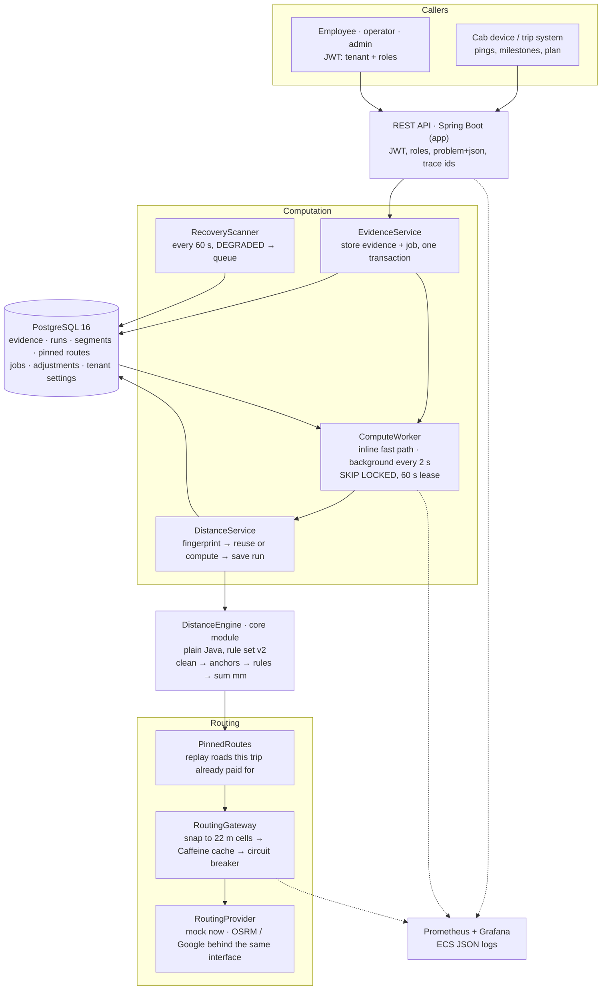
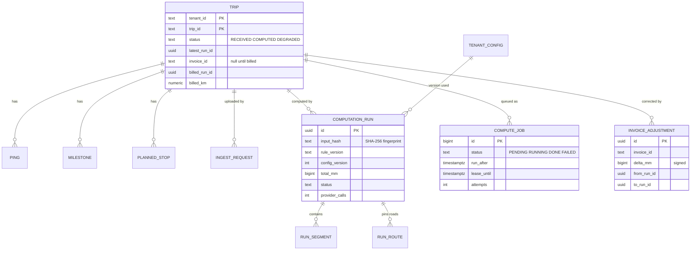
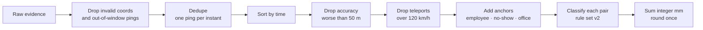
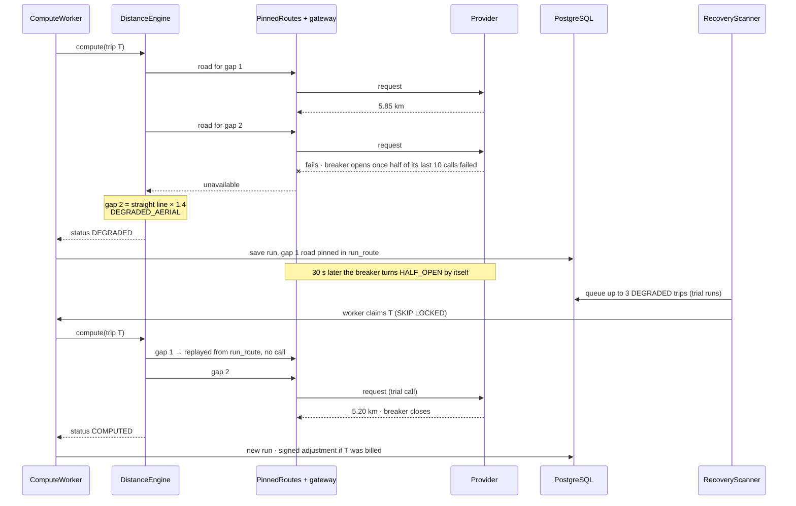

# TripLedger — Design Note

> First written before any code (S1), then kept true to what was built. This version describes the system **as built** after S10; how it moved away from the first plan is in the [change log](#13-change-log).

---

## 1. Problem in one paragraph

A vendor is paid per kilometre, and the kilometres come from GPS pings that drop out in tunnels and basements, repeat, arrive late or jump kilometres in a second. TripLedger rebuilds the billable distance of each trip so that it is **correct** (no over- or under-payment), **explainable** (every segment carries the rule that produced it), **deterministic** (same input + same rule version = same millimetres, every run) and **cheap** (paid routing calls only where a real gap exists).

**The case study's example, as a test** (`DistanceEngineTest`): a 31 km logout trip loses GPS for 22 minutes, and two drops happen inside the gap. The naive sum of pings gives **18.4 km**. TripLedger anchors both drops, routes the two real gaps (2 calls) and bills **30.61 km**, with every segment labelled.

---

## 2. Architecture



**Key rule:** `DistanceEngine` never touches the network, a database or the clock. It gets the evidence, the tenant's rules and a `RouteLookup`, and returns millimetres with a label on every segment. That makes it testable without a server (instruction 4) and deterministic.

---

## 3. Code layout and OOP

| Module | Contains | Spring? |
|---|---|---|
| `core` | Domain records, cleaning filters, anchor resolvers, segment rules, `DistanceEngine`, `EvidenceFingerprint` | **No** (`CoreModuleIsolationTest` fails the build otherwise) |
| `app` | `api` (controllers, DTOs, errors), `service`, `persistence` (Spring JDBC + Flyway), `security`, `routing`, `jobs`, `observability` | Yes |
| `bench` | `TripFactory` (10,000 realistic trips, fixed seed), `Benchmark`, k6 script | No context started |

| Principle | Where |
|---|---|
| Encapsulation | Immutable records (`GeoPoint` in micro-degrees, `Distance` in mm); validation in compact constructors |
| Inheritance | `AbstractAerialRule` shared by rules 0–2 |
| Polymorphism | `PingFilter`, `AnchorResolver`, `SegmentRule`, `RoutingProvider`, `RouteLookup` |
| Chain of responsibility | `RuleSet`: rules tried in a fixed, versioned order; first match wins |
| Decorator | `PinnedRoutes` → `TripRouting` → cache → `CircuitBreakingProvider` → provider |
| Ports and adapters | `RouteLookup` is declared in `core` and implemented in `app` |
| Layering | `TripController` → `EvidenceService` / `DistanceService` / `TripQueryService` → repositories |

---

## 4. Data model

Coordinates are **integer micro-degrees** (`lat_e6`, `lon_e6`), so equality and hashing are exact. Distances are **integer millimetres**. Every table is keyed by `tenant_id`, and every query filters on it.



| Uniqueness rule | Prevents |
|---|---|
| `ping` unique on (tenant, trip, device time, lat, lon) | The same ping counted twice (retries, overlapping uploads) |
| `ingest_request`: Idempotency-Key + body hash per trip | A retried upload being processed twice; same key with a different body is `409` |
| `milestone`, `planned_stop` unique on a dedupe key | The same event stored twice, even with missing fields |
| `computation_run` unique on (tenant, trip, input hash, rule version) **where COMPUTED** | Two identical good answers; concurrent computes of one trip collapse into one run |
| `compute_job` unique on (tenant, trip) **where PENDING** | Ten uploads in a row queueing ten computations |

---

## 5. Core algorithm



**Anchors**

| Anchor | First choice | Fallback 1 | Fallback 2 |
|---|---|---|---|
| Employee who rode | Actual pickup / drop point and time, if usable | Ad-hoc rider: profile home + sign-in time | Planned rider: planned location + planned time |
| No-show *(tenant flag)* | No-show location and time, if usable | Planned location + planned time | — |
| Office | Actual trip end (start, for logout) if within 400 m of the planned office | Planned office + that time | — |

**Segment rules, rule set `v2`.** Each consecutive pair is tested in this order and the first match decides. The order is part of the version.

| # | Condition | Distance paid | Label | Paid call? |
|---|---|---|---|---|
| 0 | Straight-line speed > 120 km/h | Straight line, flagged | `REJECTED_SPEED` | No |
| 1 | Gap < 70 s at a plausible speed | Straight line | `SHORT_GAP_AERIAL` | No |
| 2 | Gap ≥ 70 s, speed < 5 km/h | Straight line | `PARKED` | No |
| 3 | Routing unavailable (breaker open, call failed) | Straight line × 1.4 | `DEGRADED_AERIAL` | Failed |
| 4 | Road distance > 100 km | Straight line, flagged | `REJECTED_DISTANCE` | Yes |
| 5 | Road speed > 120 and straight line × 1.4 speed > 120 | Straight line, flagged | `REJECTED_SPEED` | Yes |
| 6 | Otherwise | Road distance | `ROUTED` | Yes |

Rule 0 comes first because a road is never shorter than the straight line: if even the straight line is impossible, a paid call can't help. **v2** (S9): a move within GPS accuracy (50 m) counts as speed 0 whatever the time between the points, so a drop logged 0.1 s after a ping 20 m away is not "720 km/h". This changes labels only, never km.

**Units and determinism**

| Topic | Decision |
|---|---|
| Distance | Haversine, Earth radius 6,371,008.8 m, `StrictMath` (bit-identical on every machine) |
| Unit | Integer millimetres per segment; integer sum, so order and threads can't change it |
| Rounding | Once, at the trip total: HALF_EVEN to 10 m, shown as km with 2 decimals (as strings in JSON) |
| Same answer twice | Fingerprint = SHA-256 of the sorted evidence + tenant rules + rule version. Same fingerprint → the saved run is reused, with no new routing calls |
| Map changes | Every road distance a run used is pinned (`run_route`) and replayed for that trip, so a provider map update never moves an old bill |

---

## 6. APIs

| Method | Path | Roles | Purpose |
|---|---|---|---|
| `POST` | `/v1/trips/{tripId}/evidence` | OPERATOR, ADMIN | Upload pings, milestones, plan (`Idempotency-Key` required). Several uploads per trip are fine |
| `GET` | `/v1/trips/{tripId}/distance` | EMPLOYEE (own trips), OPERATOR, ADMIN | Billable km, status, rule + settings version, routing calls |
| `GET` | `/v1/trips/{tripId}/breakdown` | OPERATOR, ADMIN | Every segment with its rule, cleaning report, anchors used |
| `GET` | `/v1/trips?status=DEGRADED` | ADMIN | Trip list, e.g. the recovery backlog |
| `POST` | `/v1/trips/{tripId}/recompute` | ADMIN | Compute again; unchanged input gives back the same run |
| `POST` | `/v1/trips/{tripId}/bill` | ADMIN | Freeze the current run and km on an invoice |
| `GET` | `/v1/trips/{tripId}/adjustments` | OPERATOR, ADMIN | Signed corrections since billing, and the total charged |
| `GET` `PUT` | `/v1/tenant/config` | ADMIN | Company billing settings, versioned |
| `GET` | `/v1/admin/status` · `PUT /v1/admin/routing/mock` | ADMIN | Routing and queue health · demo outage switch (mock only) |
| `POST` | `/v1/dev/tokens` | anyone, local only | A token for any tenant and role (off anywhere real) |

Errors are RFC 7807 `application/problem+json` with a stable `code` and a `traceId`: never stack traces, SQL or personal data. A trip of another company is **404**, never 403.

---

## 7. Routing cost and caching

```
engine needs a road ─▶ PinnedRoutes (this trip paid before?) ─▶ snap both ends to 22 m cells ─▶ Caffeine ─┬─ hit: free
                                                                                                         └─ miss ─▶ breaker ─▶ provider
```

| Technique | Effect (10,000-trip benchmark) |
|---|---|
| Rules 0–2 decide before any lookup | 99.85 % of segments never need a road: 15.5 M pairs → 23,296 lookups |
| Cache key = (start cell, end cell); the provider is asked about **cell centres** | Answer depends only on the key, so trip order never changes a bill. Cost: ≤ ~31 m per routed gap |
| Cache in front of the breaker, failures never cached | During an outage, known roads still answer (583 trips stayed COMPUTED); the next trip retries a failed road |
| Single flight per key (`Caffeine.get(key, loader)`) | Concurrent misses for one road share one call |
| Per-trip `RoutingUsage`, stored on every run | Calls before / after caching are visible per trip: **0.78 paid calls per trip** |
| Batching | Deliberately not built (A27): only ~2 gaps per trip need a road, and batching would route gaps the rules never need |

**What can be stale, for how long, and what bounds it (plus point 7)**

| Data | Lives in | Eviction | Can be stale for | Bounded by |
|---|---|---|---|---|
| Road distance between two cells | Caffeine, in the app's memory | W-TinyLFU, max 100,000 roads; expire 7 days after write | Up to 7 days after the map changes | TTL; failures are never cached; a restart empties it |
| Road distance a run already billed on | `run_route` table (pinned) | Never | **On purpose**, for the life of that trip | A bill must not move because a map changed. New gaps still ask the provider |
| A trip's km right after an upload | `trip.status = RECEIVED` | — | Normally 0 (computed inline), at most one worker poll (2 s) | The API says `RECEIVED` instead of showing old km |
| A `DEGRADED` (× 1.4) answer | `trip` + latest run | Replaced by recovery | Breaker wait (30 s) + one scan (≤ 60 s) after the provider is back | Labelled `DEGRADED`; if billed meanwhile, the correction is a signed adjustment |
| Tenant billing settings | Database, read on every computation | — | Never | Each run records the settings version it used |
| Roles in a token | The JWT | — | Up to the token lifetime (8 h) | Short-lived tokens |

L2 Redis was planned for several app instances and wasn't built: with one instance it would only add a moving part (trade-off below).

---

## 8. Failure handling

**As built:**
- **Outbox.** An upload stores its evidence **and** a compute job in one transaction, so neither can exist without the other.
- **Two paths, one queue.** After commit, the request claims its own job and computes inline (fast path, usually done before the response). A background worker claims anything left every 2 s with `FOR UPDATE SKIP LOCKED` and a 60 s lease (slow path). A dead worker's job is taken again once its lease runs out.
- **Retries.** A failing job backs off 10 s, 30 s, 90 s, … (max 10 min) and is `FAILED` after 5 attempts. Only the exception type is stored, because messages can carry data.
- **Provider down.** Once half of the last 10 calls have failed (at least 5 calls made), the breaker opens. Gaps fall back to straight line × 1.4 and the trip is `DEGRADED`. After 30 s the breaker moves to HALF_OPEN **on a timer**. `RecoveryScanner` then queues as many trips as it allows trial calls (3), and a full batch of 100 once it is CLOSED. This works even when no new trips arrive.
- **Billing.** `POST /bill` freezes run + km. A later **COMPUTED** run that changes the km adds a signed `invoice_adjustment` (`+1.80`) in the same transaction. The invoice is never edited, and a `DEGRADED` guess never creates an adjustment.

### Hardest flow: the provider fails mid-trip, then recovers



### Failure-mode table

| What fails | What the user sees | How the system recovers |
|---|---|---|
| Routing provider down | Trip `DEGRADED` with provisional km (× 1.4) | Breaker opens at 50 % failures, HALF_OPEN after 30 s, trial trips, then all `DEGRADED` trips recomputed; signed adjustment if already billed |
| Provider back, but nobody uploads | Nothing | Timer moves the breaker to HALF_OPEN; recovery scan sends trial trips (S9 fix) |
| Worker crashes mid-compute | Trip stays `RECEIVED` a little longer | 60 s lease runs out, another worker reruns it; same fingerprint, same answer |
| A job keeps failing | Trip stays as it was | Back-off retries, then `FAILED`; visible on the dashboard (`failed_24h`) |
| Duplicate upload (retry) | Same `202` answer, `replayed: true` | Idempotency-Key + body hash; ping unique index |
| Same key, different body | `409 EVIDENCE_CONFLICT` | The client must use a new key for new data |
| Out-of-order or late pings | Nothing | Sorted at compute time; the trip is recomputed with everything it has |
| Late pings after billing | Adjustment line, e.g. `+1.50 km` | New run; signed delta; invoice untouched |
| Two computes of one trip at once | Nothing | One saves the run, the other hits the unique index and reuses it |
| App restart (cache lost) | A few more paid calls for a while | Cache refills on demand; billed trips replay pinned roads |
| PostgreSQL down | `500` with a `traceId`, no internals | Devices retry with the same Idempotency-Key once it is back |
| Bad or foreign token | `401`; other company's trip `404` | — |
| Device clock wrong | Pings far outside the window ignored | Window ± 10 min tolerance |

---

## 9. Security and tenancy

| Role | Can do |
|---|---|
| `EMPLOYEE` | Read the km of trips they rode in (their ref is in the milestones or plan), nothing else |
| `OPERATOR` | Upload evidence; read any trip of their company, its breakdown and adjustments |
| `ADMIN` | Everything in their company: trip list, recompute, billing, settings, system status |

- JWT bearer tokens with `sub`, `tenant_id` and `roles`, HS256 for local runs. In production the decoder would verify the company login system's keys; nothing else changes. Missing or invalid tenant, unknown role, expired, foreign issuer or foreign signature → `401`.
- The tenant comes **only** from the token, never from a path, header or body, and every query filters on it. Cross-tenant reads are **404**.
- No personal data in logs or errors: bodies are never logged, employees are opaque refs, and a test scans the log of a full upload + read for the employee ref and the drop coordinates.

---

## 10. Observability

- **Metrics** (Micrometer → Prometheus, scraped every 5 s): lag (`tripledger_jobs_oldest_pending_age_seconds`), queue depth (`tripledger_jobs_queue{status}`), retries and failures (`tripledger_jobs_finished_total{outcome}`), rejections (`tripledger_segments_total{rule="REJECTED_*"}`), routing cost (`tripledger_routing_lookups_total{source}`), breaker state, cache hit ratio, compute time, API rate / latency / error rate. No tenant or trip id is ever a metric tag.
- **Dashboard:** Grafana, provisioned from files: 15 panels, from "right now" health to API latency.
- **Logs:** ECS JSON in Docker, with `traceId` on every request and `tenantId` / `tripId` on worker jobs.
- **Ops view:** `GET /v1/admin/status`, used by the demo console.

---

## 11. Complexity and scaling limits

| Step | Time | Space |
|---|---|---|
| Sort | O(n log n) | O(n) |
| Filters, anchors, rules, sum | O(n) | O(n) |
| Routing | O(g) lookups for g real gaps, 0.78 paid calls per trip after caching | O(1) per lookup |

**Measured** ([bench/results.md](../bench/results.md), i5-13420H laptop): 10,000 trips × ~1,570 pings take 7.4 s on one core (p99 2.43 ms per trip) with an 89 MB peak heap, or 1.9 s on 12 threads. Through the API on the Docker stack: 10,091 pings/s ingested, upload p99 977 ms, reads p99 under 300 ms.

**Where it stops scaling, in order:**
1. **Database writes**, measured as the first limit. Every upload recomputes the trip so far and stores every segment of the new run, so a trip uploaded in 5 parts does 15 parts of work. Fixes: recompute after the trip goes quiet (debounce), store plain short-gap segments as one summary row, partition `ping` by day and tenant (3 M trips × 1,500 pings ≈ 4.5 billion rows a month).
2. **Provider quota.** At 50 calls/s and 0.78 calls per trip, one key covers ≈ 64 trips/s. Recompute bursts after an outage hit this first.
3. **CPU**, last: 1,357 trips/s per core.

---

## 12. Trade-offs and what was left out

**Consistency vs availability vs latency**

| Decision | Chose | Gave up | Why |
|---|---|---|---|
| Provider outage | **Availability**: provisional km (× 1.4), marked `DEGRADED` | Exactness, for a while | Billing never stops; recovery + signed adjustment restores the exact km (benchmark: 10,000 / 10,000 identical) |
| Billing and adjustments | **Strong consistency**: run + adjustment in one transaction, unique indexes | Some write throughput | Money must never be counted twice or lost |
| Compute on upload | **Latency**: inline fast path, so the response usually has the km | Repeated work for trips uploaded in parts | Simple for clients; debounce is the known next step |
| Snapped-cell cache | **Cost**: 66.7 % hit rate | ≤ ~31 m per routed gap | Answer depends only on the cells, so it never drifts between runs |
| Pinned roads | **Stable bills** | A billed trip ignores later map fixes | A bill moving because a map changed is the bug vendors complain about |
| Rejected segments | Pay the straight line only | A real detour may be under-paid | Flagged for review; never over-pay on bad data |
| Queue in PostgreSQL | One fewer system, one-command run | Kafka-scale throughput | `SKIP LOCKED` + leases are enough at this scale |
| Tenant isolation in the app | Simplicity | A second wall (row-level security) | One service, tenant only from the token, every query filtered, cross-tenant tests |

**Left out on purpose:** request batching (A27) · Redis L2 cache (single instance) · PostgreSQL row-level security · a rate limiter for a real provider (the mock has no quota) · alerting rules (the dashboard shows the thresholds) · a shadow determinism check · HMM map-matching of every ping · live distance during the trip · GPS-spoofing detection · tolls, waiting and night charges · production SSO.

---

## 13. Change log

How the build moved away from the S1 plan, and why.

| Segment | Change |
|---|---|
| S2 | Invalid coordinates dropped before dedupe; dedupe tie-breaks and the teleport re-anchor guard specified |
| S3 | Out-of-window pings dropped first; anchors at the same instant within 50 m count as one spot; `TripDistance` records route requests and answers |
| S4 | Routing inside `app`, no separate mock service. H3 cells + geometry guard replaced by a 0.0002° grid with the provider asked about cell centres. Batching dropped (A27); Redis L2 left optional |
| S5 | Trips keyed by (`tenant_id`, `trip_id`), not a surrogate UUID. Spring JDBC, not JPA. Tests on a real PostgreSQL (Compose locally, service container in CI) instead of Testcontainers |
| S6 | HS256 for local runs (not RS256); tenant only from the token; versioned tenant settings; row-level security not built (trade-off) |
| S7 | Inline fast path + queue as the durable fallback, instead of queue-only; billing as columns on `trip`, not BILLED / ADJUSTED states; pinned roads in `run_route` (planned name: `route_evidence`); no optimistic lock needed, the unique run index settles races |
| S8 | Metrics as `tripledger_*`, Grafana dashboard, ECS logs, Docker image, admin status + demo outage switch, demo console. No alert rules, no shadow determinism check |
| S9 | `bench` module + k6. Two benchmark findings fixed: rule set **v2** (tiny moves are never "speeding") and recovery with no new traffic (timer-driven HALF_OPEN, trial batches, recovery batch skips trips that already have a job). The runnable jar is now `app-…-exec.jar` so `bench` can use `app` as a library |
| S10 | This note rewritten "as built"; caching staleness table; trade-offs and left-out list in the README |
